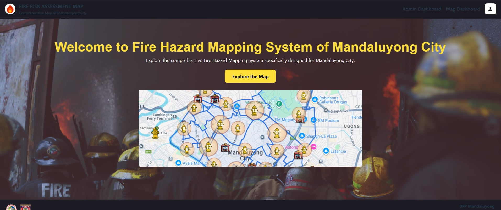
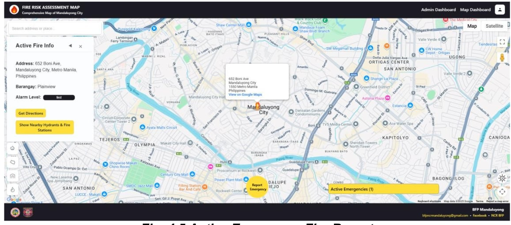
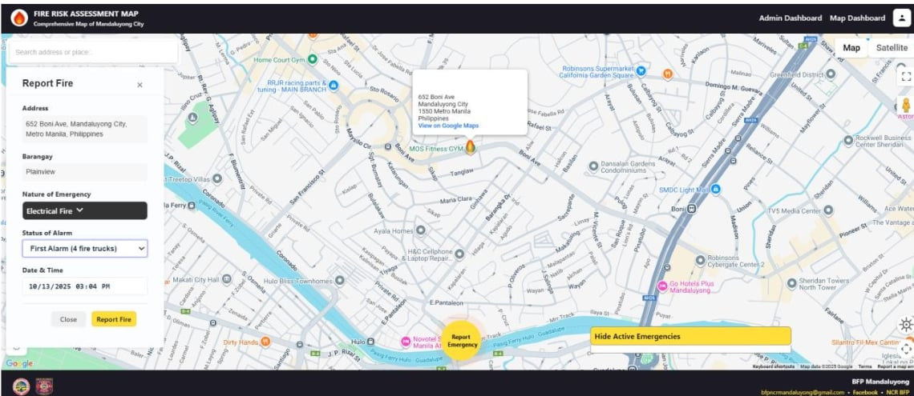
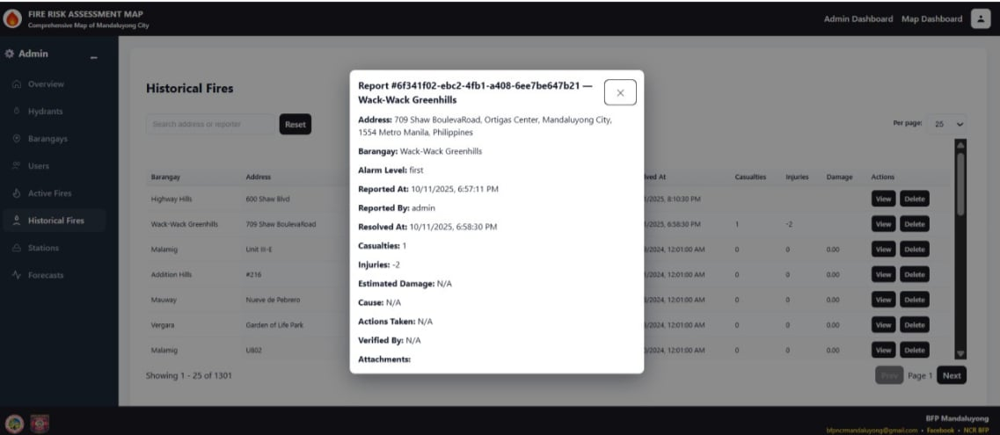
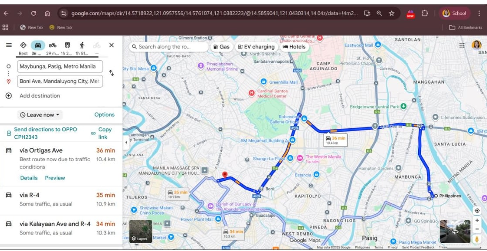

# Fire Hazard Mapping System of Mandaluyong City

A GIS-based web platform for fire risk assessment, spatial hazard mapping, and incident tracking in Mandaluyong City, with time-series forecasting for proactive fire risk evaluation. Built as a capstone project in partnership with the Bureau of Fire Protection (BFP) Mandaluyong.

**Published and presented at ICMLAS 2026.**

## My Role: Project Manager

This was a four-person team project. I served as the project manager and was responsible for:

* **Planning:** setting the project timeline and breaking the work into tasks.
* **Client communication:** working directly with the BFP client.
* **Requirements gathering:** collecting and organizing what the system needed to do.
* **Documentation:** writing the project documentation.
* **UI design:** designing the interface of the system.
* **Data collection:** gathering the data used in the system.

## System Overview

* **Platform Architecture:** Full-stack GIS web application built with React, Node.js, Express, TypeScript, and PostgreSQL.
* **Spatial & Mapping Core:** Map layers for barangay boundaries, fire hydrant networks, and facility locations.
* **Predictive Analytics:** Time-series forecasting for proactive fire risk evaluation.
* **Role-Based Access:** Admin controls and public reporting interfaces.

## System Interface & Previews

### 1. Landing Page / Main Portal

### 2. Active Emergency Fire Report Interface

### 3. Real-Time Fire Incident Reporting

### 4. Past Fire Incident Analytics

### 5. Tracking Using GIS Spatial Mapping

## Key Features

* Interactive GIS mapping of fire stations, hydrants, and hazard zones.
* Emergency reporting and status tracking.
* Administrative dashboards for records, risk levels, and spatial analytics.

## Source Code

The source code was written and is maintained by the development team and is not included in this repository. This repository documents the system, its interface, and my role as project manager.

## Author

**Evan Gelo T. Lazo**: IT Graduate, José Rizal University (2026)
[github.com/GeloLazo](https://github.com/GeloLazo)
